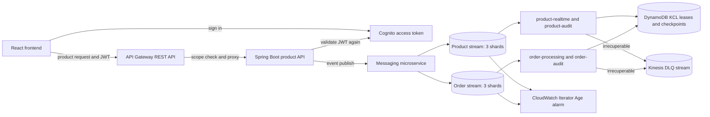

# EV3: API Manager y flujo de eventos

## Qué significa API Manager en PC Mania

En la pauta, **API Manager** se refiere a Amazon API Gateway. No es el
`KinesisAdminService`: API Gateway es la entrada HTTP para el frontend, mientras
que el administrador de Kinesis ejecuta operaciones de streams y consumidores.

La infraestructura repetible de este API está en
[`infra/api-gateway-stack.yaml`](../infra/api-gateway-stack.yaml). Crea una REST
API regional con:

- Un autorizador Cognito User Pools que acepta uno o varios User Pool ARN.
- Validación de los scopes `pcmania-api/read`, `pcmania-api/write` y
  `pcmania-api/order` (el último se debe habilitar en el App Client de la tienda).
- Rutas de lectura y escritura para `/api/productos`, `/api/productos/{id}` y
  `POST /api/ordenes`.
- Integración HTTP proxy hacia el backend Spring Boot y respuestas CORS para
  preflight y errores.

El backend vuelve a validar el access token: issuer, firma, expiración,
`token_use`, `client_id` y scopes. La validación en Gateway no reemplaza la del
backend.

## Diagrama de secuencia

```mermaid
sequenceDiagram
    actor Usuario
    participant Frontend as React frontend
    participant Cognito as Amazon Cognito
    participant Gateway as Amazon API Gateway
    participant Backend as Product API
    participant Mensajeria as Messaging service
    participant PanelAPI as Messaging admin API
    participant Kinesis as Kinesis Data Streams
    participant Consumidor as KCL consumer
    participant Dynamo as DynamoDB

    Usuario->>Frontend: Inicia sesión
    Frontend->>Cognito: Autenticación
    Cognito-->>Frontend: Access token
    Frontend->>Gateway: POST /api/productos con Bearer token
    Gateway->>Gateway: Cognito authorizer valida token y scope write
    Gateway->>Backend: HTTP proxy; reenvía JWT y solicitud
    Backend->>Backend: Valida JWT y scope nuevamente
    Backend->>Backend: Registra producto en inventario en memoria
    Backend->>Mensajeria: Publica product.created con JWT
    Mensajeria->>Kinesis: PutRecords en stream de productos
    Kinesis-->>Consumidor: Entrega registro al shard
    Consumidor->>Consumidor: Valida, deduplica y procesa
    Consumidor->>Dynamo: Guarda checkpoint KCL
    Frontend->>PanelAPI: Consulta estados de eventos y consumers
    PanelAPI-->>Frontend: Estado, sequence number y leases

    Usuario->>Frontend: Confirma carrito
    Frontend->>Gateway: POST /api/ordenes con Bearer token
    Gateway->>Backend: Reenvía la solicitud autenticada
    Backend->>Backend: Valida stock y calcula el total
    Backend->>Dynamo: Persiste la orden
    Backend->>Mensajeria: Publica order.created con JWT y firma HMAC
    Mensajeria->>Mensajeria: Verifica firma y consistencia del evento
    Mensajeria->>Kinesis: PutRecords en stream de órdenes
    Backend-->>Frontend: Orden creada y total
```

Si un evento es inválido o irrecuperable, el consumidor lo publica en el stream
DLQ. Si no puede guardar el registro en el DLQ, no avanza el checkpoint del
lote. Los fallos simulados se activan desde los metadatos de demostración.

## Flujo alternativo de SNS/SQS

Cuando está habilitada la publicación SNS, el mismo backend envía el evento al
microservicio de mensajería. SNS realiza fanout hacia las colas filtradas; los
consumidores confirman el mensaje con `DeleteMessage`, o SQS lo deriva a su DLQ
según la Redrive Policy. SNS/SQS continúa funcionando junto a Kinesis.

Los endpoints internos de publicación de órdenes validan una firma HMAC
generada por el backend. `ORDER_EVENT_SHARED_SECRET` debe coincidir entre
backend y mensajería y nunca guardarse en el repositorio. El launcher crea
una clave temporal compartida cuando no está configurada.

## Despliegue del API Gateway

El stack de API Gateway **no aloja el backend** ni crea Cognito. Requiere que el
backend ya tenga un origen público HTTPS y que se conozcan los ARN de los User
Pools. `localhost` no es una dirección alcanzable desde API Gateway.

### Uso temporal de ngrok

El repositorio no contiene código que inicie ngrok. Si ngrok se usa para la
demo, el túnel que necesita API Gateway debe apuntar al **backend**:

```powershell
ngrok http 8080
```

La URL HTTPS que entrega ngrok se usa como `BackendOrigin`. Un túnel que solo
expone Vite (`5174` para admin o `5173` para tienda) publica la página, pero no
permite a API Gateway alcanzar el backend. Si el navegador también carga el
frontend desde ngrok, agrega ese origen a `CORS_ALLOWED_ORIGINS`; el túnel del
frontend y el del backend son URL distintas. La URL temporal debe seguir activa
durante la demo y, si cambia, hay que actualizar el stack y las variables del
frontend/backend.

El API Gateway agrega `ngrok-skip-browser-warning: true` a sus llamadas proxy
para evitar que el aviso del plan gratuito de ngrok sustituya las respuestas
reales del backend.

En un frontend público, `VITE_API_URL` no puede ser `localhost`: el navegador del
visitante interpretaría esa dirección como su propio equipo. El panel
administrativo también llama directamente al microservicio de mensajería con
`VITE_MESSAGING_API_URL`; esas operaciones no están detrás del API Gateway y
requieren una ruta accesible aparte. No expongas ese servicio públicamente sin
mantener su autenticación y controles de acceso.

Para consumir API Gateway desde la tienda local, inicia el launcher con la URL
base que entrega CloudFormation. El túnel ngrok debe seguir exponiendo el
backend en `localhost:8080` mientras Gateway lo utiliza como `BackendOrigin`:

```powershell
.\start-demo.ps1 -EnableSnsSqs -EnableKinesis `
  -ApiBaseUrl "https://<api-id>.execute-api.us-east-1.amazonaws.com/prod"
```

Con el perfil AWS local previamente configurado, el despliegue puede iniciarse
desde la raíz del repositorio:

```powershell
.\infra\deploy-api-gateway.ps1 `
  -Region us-east-1 `
  -BackendOrigin "https://<origen-publico-del-backend>" `
  -CognitoUserPoolArns "arn:aws:cognito-idp:us-east-1:<cuenta>:userpool/<pool-tienda>,arn:aws:cognito-idp:us-east-1:<cuenta>:userpool/<pool-admin>" `
  -AllowedOrigin "https://<origen-del-frontend>" `
  -Profile pcmania-demo
```

El script imprime `ApiBaseUrl`. Configura esa URL como `VITE_API_URL` en los
frontends y reinicia Vite. Si se usa un solo User Pool, pasa un solo ARN. No
incluyas credenciales, tokens ni claves en el repositorio o en el comando.
El script publica una nueva versión de la API después de aplicar el stack.

En el backend configura `CORS_ALLOWED_ORIGINS` con los orígenes reales del
frontend, separados por comas. El `AllowedOrigin` del stack también debe ser el
origen del navegador; su valor predeterminado `*` facilita una prueba inicial,
pero se debe restringir antes de una exposición pública.

Para borrar únicamente el stack de API Gateway:

```powershell
.\infra\cleanup-api-gateway.ps1 -Region us-east-1 -Profile pcmania-demo
```

El panel conserva `VITE_MESSAGING_API_URL` para operaciones administrativas
directas al microservicio de mensajería. Para demostrar órdenes por API Gateway,
la tienda envía `POST /api/ordenes`; el backend comprueba y descuenta stock en
memoria, calcula el total, guarda una copia de la orden en DynamoDB si se inicia
con `ORDERS_PERSISTENCE=dynamodb`, y publica `order.created` en el stream de
órdenes.
La publicación desde el panel de estado Kinesis es solo un simulador, no una
orden real.

En un despliegue cloud, `MESSAGING_SERVICE_URL` y `KINESIS_SERVICE_URL` del
backend deben apuntar a la dirección de mensajería accesible desde el backend.
El template de API Gateway no crea ni expone ese servicio.

## Alcance pendiente y preparación de la demo

- El inventario sigue en memoria. Las órdenes pueden persistirse en la tabla
  DynamoDB `pc-mania-orders` activando `ORDERS_PERSISTENCE=dynamodb`; al usar
  `-EnableCloudOrders`, el launcher verifica que la tabla esté activa. El
  stack de Kinesis también crea esta tabla y su limpieza la elimina.
- El stack de API Gateway espera un backend ya desplegado y accesible por HTTPS;
  no crea EC2, balanceador, certificado TLS ni red.
- No se ha desplegado ningún recurso AWS desde este cambio. Primero hay que
  confirmar el origen público del backend, los User Pool ARN y la cuenta/región.
- Antes de la exposición, conviene crear los streams y comprobar los permisos
  AWS; al terminar, eliminar los recursos que generen costo con sus scripts de
  cleanup.

## Diagrama de componentes EV3


